<p align="center">
  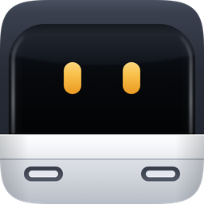
</p>

<h1 align="center">BotBus</h1>

<p align="center">
  <strong>Your AI agents, anywhere you go.</strong><br>
  Follow the coding agents running on your computer from your phone and watch:<br>
  approve requests, reply, start new tasks, open what they built,<br>
  and take over the screen when they get stuck.
</p>

<p align="center">
  <a href="https://botbus.io/en/">Website</a> ·
  <a href="https://botbus.io/en/#download">Download for Mac</a> ·
  <a href="https://botbus.io/en/docs/security.html">Security</a> ·
  <a href="https://botbus.io/en/docs/connect-agent.html">Connect your agent</a> ·
  <a href="https://github.com/botbus-io/botbus-protocol">Protocol</a> ·
  <a href="#简体中文">简体中文</a>
</p>

<p align="center">
  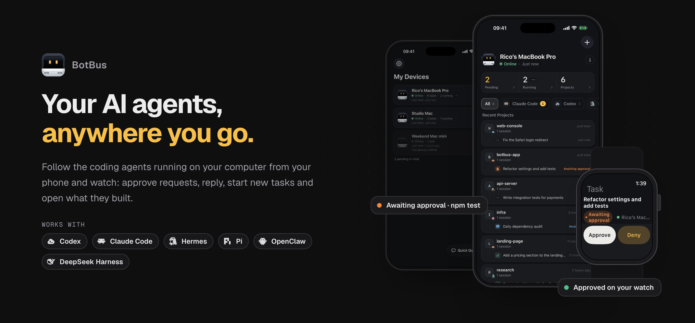
</p>

## Why BotBus

Coding agents such as Codex and Claude Code do their best work on your own computer, next to your repositories, tools and credentials. The catch is that the moment you step away, you lose the ability to check on them, answer their questions or approve their next command.

BotBus fixes that. A small menu bar app on your computer watches every agent session, and the companion apps on your phone and watch let you reach those agents from anywhere. The agents keep running where they are, nothing is moved to the cloud, and everything that travels between your devices is end-to-end encrypted.

## Features

<table>
  <tr>
    <td align="center" valign="top" width="25%">
      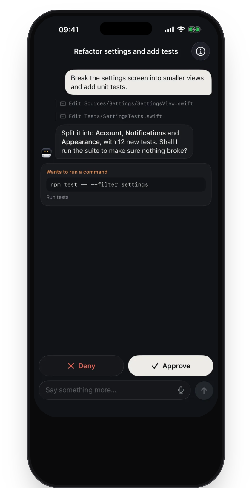<br>
      <strong>Approve in a tap</strong><br>
      When an agent needs to run a command, it alerts you. Approve, deny, or add a follow-up from your phone or watch.
    </td>
    <td align="center" valign="top" width="25%">
      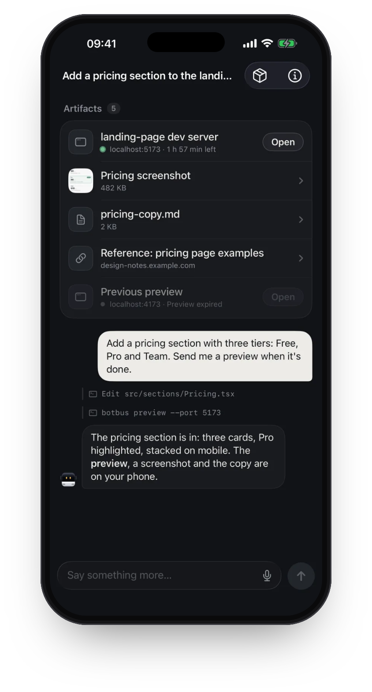<br>
      <strong>Results, straight to your phone</strong><br>
      Pages, screenshots, videos and documents come back with the task, ready to open.
    </td>
    <td align="center" valign="top" width="25%">
      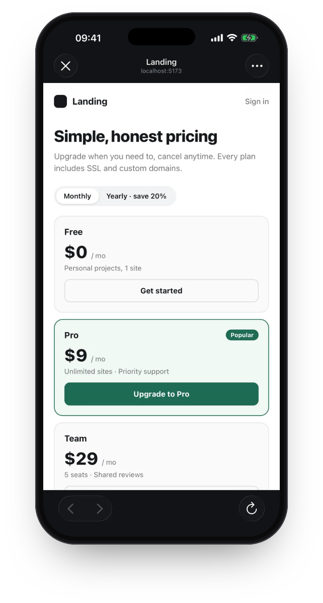<br>
      <strong>Preview web pages on your phone</strong><br>
      Open the dev server your agent started, without going back to your computer.
    </td>
    <td align="center" valign="top" width="25%">
      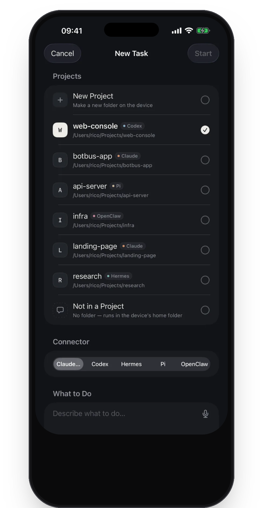<br>
      <strong>New tasks, on the go</strong><br>
      Pick a computer, a project and an agent, say the word, and you're off.
    </td>
  </tr>
</table>

And everything else you would expect from the desk:

- **Every session, in one place.** Sessions you start in your own terminal or IDE show up too, grouped by computer and project, with live status.
- **Follow up, interrupt, switch models.** Continue a conversation, stop a running task, and pick the model and thinking effort for the next turn.
- **Answer questions with a tap.** When an agent asks a multiple-choice question, the options appear as buttons.
- **Talk or type.** Voice input on phone and watch. Send photos and files to the agent, and see the images it generates.
- **Review the diff.** Look at a task's uncommitted changes from your phone before you approve or merge.
- **Start in a new project.** Create a fresh project folder from your phone and put an agent to work in it.
- **Notifications that keep your privacy.** Get notified when an agent needs approval, needs a reply, finishes or fails. The notification text is encrypted too.
- **iPad included.** Split view: computers and projects on the left, tasks and results on the right.
- **11 languages.** The apps are localized in Simplified and Traditional Chinese, English, Japanese, Korean, French, German, Spanish, Italian, Brazilian Portuguese and Russian.

## Take over the screen when an agent gets stuck

Some steps only a human can do: a login page, a password prompt, a confirmation dialog. When an agent hits one, open a live view of your computer's desktop on your phone and finish the step yourself. Your finger is the mouse and the phone keyboard is the keyboard.

- **Live video, not a slideshow.** The screen streams as H.264, so scrolling and typing feel immediate, at a fraction of the bandwidth of sending screenshots.
- **Encrypted like everything else.** Frames, taps and keystrokes are sealed with a key derived from your group key. The relay only forwards ciphertext.
- **Shows up when it matters.** If an agent stops to wait for input while a password field is focused on the computer, BotBus attaches a remote-control view to that task and says so in the notification.
- **Your computer, your rules.** Switch it on and off per computer from your phone. It needs the Screen Recording permission on the computer, plus Accessibility to send clicks and keystrokes; without the latter, the view is read-only.

## Works with your agents

<p align="center">
  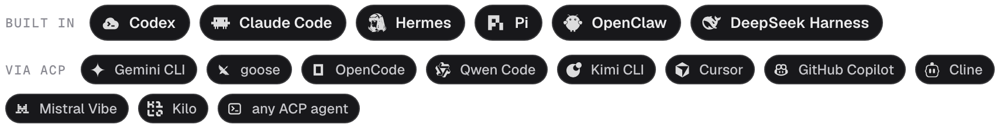
</p>

Six agents are built in and deeply integrated: [Codex](https://openai.com/codex/), [Claude Code](https://claude.com/product/claude-code), [Hermes](https://hermes-agent.nousresearch.com/), [Pi](https://pi.dev/), [OpenClaw](https://openclaw.ai/) and [DeepSeek Harness](https://github.com/deepseek-ai/deepseek-harness).

Any agent that speaks the [Agent Client Protocol](https://agentclientprotocol.com) (ACP) can join as well. Agents from the ACP registry, such as Gemini CLI, goose, OpenCode, Qwen Code, Kimi CLI, Cursor, GitHub Copilot, Cline, Mistral Vibe and Kilo, are discovered automatically once installed. Your own or your company's agent only needs a small manifest file, and a "reverse extension" lets sessions started in its own UI show up live on your phone. Tasks started from the phone come with a bundled `botbus` MCP server, so any agent can hand screenshots, files, links and dev-server previews back to you. ACP support requires BotBus for Mac 1.1 or later.

→ [Connect your own agent](https://botbus.io/en/docs/connect-agent.html)

## Apple Watch

Once your watch syncs pairing from your phone, it connects on its own. Common actions don't require pulling out your phone.

<table>
  <tr>
    <td align="center" width="25%">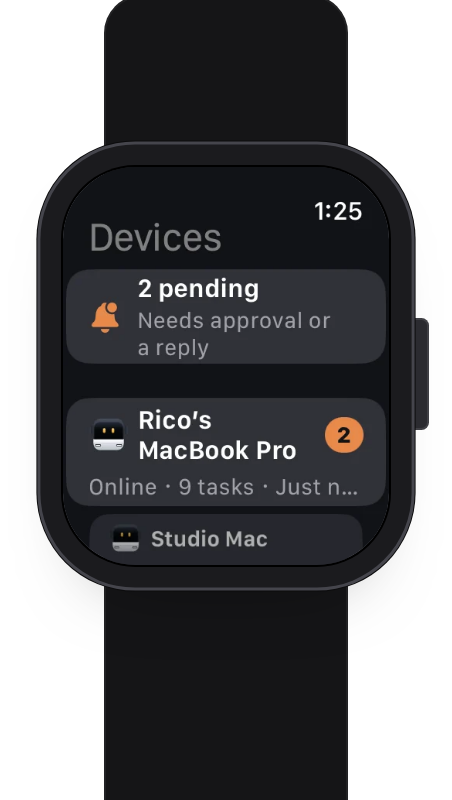<br>All devices</td>
    <td align="center" width="25%">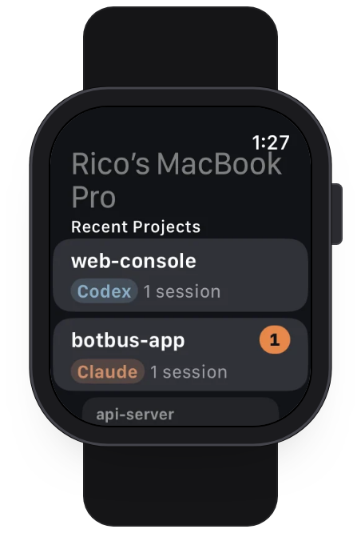<br>Recent projects</td>
    <td align="center" width="25%">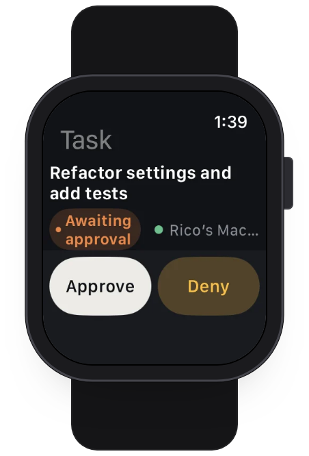<br>Approve or deny</td>
    <td align="center" width="25%">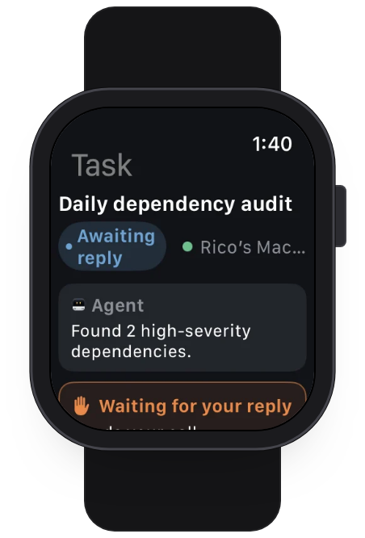<br>Reply by voice</td>
  </tr>
</table>

## Pair every device you own

<table>
  <tr>
    <td valign="top">
      Multiple computers and multiple phones can pair with each other. One phone can run the agents on several computers, one computer can be paired with several phones, and everyone in the group sees the same state. Tasks are listed by computer and project, so a MacBook at the office and a Mac mini at home never get mixed up.
      <br><br>
      Devices are managed separately: remove a single computer or revoke a single phone at any time, and it is disconnected immediately. The Apple Watch pairs through your iPhone; no extra setup needed.
    </td>
    <td align="center" width="240">
      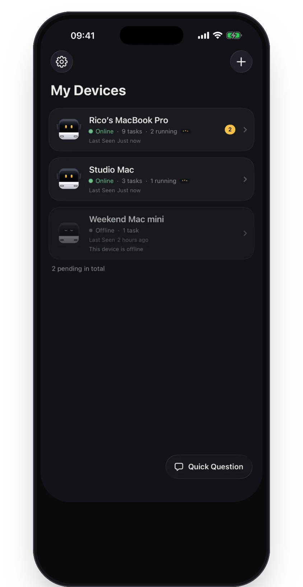
    </td>
  </tr>
</table>

## End-to-end encrypted

Only your devices can read your content. Conversations, tasks, commands, images, notification text and remote-control screens are encrypted on your device with AES-256-GCM before they leave it. The relay server only forwards and temporarily holds ciphertext it cannot read.

```text
your computer                     relay (Cloudflare)                 your phone / watch
agent sessions ──▶ encrypt ──▶  forwards & queues ciphertext  ──▶ decrypt ──▶ tasks, approvals
      ▲                          sees only ids, online status,                      │
      └────────── decrypt ◀────  timestamps and sizes           ◀──── encrypt ◀─────┘
```

- **The key never goes online.** The group key is handed to your phone through the QR code on your computer's screen (X25519 key exchange, HKDF-SHA256 sub-keys). It never passes through the server and lives only in each device's keychain.
- **You can check it yourself.** Your computer and phone each show an 8-character key fingerprint. If they match, it's the same key.
- **The server sees only what routing needs.** Device IDs, online status, update times and ciphertext sizes. Pairings idle for 30 days are cleared automatically.
- **Honest about the edges.** Developer previews (sharing a dev-server page from your computer to your phone) are proxied through the server and are not end-to-end encrypted.

→ [How we encrypt, in detail](https://botbus.io/en/docs/security.html)

## Platforms

| Platform | Status |
|---|---|
| macOS (menu bar app) | Available now. Signed and notarized universal build for Apple Silicon and Intel, macOS 26 or later. |
| iPhone + Apple Watch | Supported. iOS 26 and watchOS 26 or later; the watch app installs with the iPhone app. |
| Android | Supported. |
| Windows | Planned. |

Downloads and release status live on [botbus.io](https://botbus.io/en/#download).

## Get started

1. **Install BotBus on your computer.** It lives in the menu bar and discovers the agents on your computer automatically.
2. **Scan to pair your phone.** Choose "Pair a Phone…" from the BotBus menu and scan the QR code.
3. **The watch syncs automatically.** Pairing info syncs from your iPhone to your Apple Watch.

Whether you can act on a task depends on connector support, the task's state and whether your computer is online. Viewing already-synced tasks works even while the computer is offline.

## Open source

- [botbus-protocol](https://github.com/botbus-io/botbus-protocol): the wire protocol between the computer app and its clients, the ACP integration contract, the compatibility policy and public fixtures. Apache-2.0.

## Contact

[botbus.io](https://botbus.io) · support@botbus.io

<br>

---

# 简体中文

<p align="center">
  <strong>随时随地，接管你的 AI Agent。</strong><br>
  在手机和手表上查看电脑里正在运行的 Agent，随手审批、续聊、派新活、看成果，<br>
  卡住了还能直接操作电脑屏幕。
</p>

<p align="center">
  <a href="https://botbus.io/">官网</a> ·
  <a href="https://botbus.io/#download">下载 Mac 版</a> ·
  <a href="https://botbus.io/docs/security.html">端到端加密</a> ·
  <a href="https://botbus.io/docs/connect-agent.html">接入你自己的 Agent</a> ·
  <a href="https://github.com/botbus-io/botbus-protocol">协议</a>
</p>

## 为什么需要 BotBus

Codex、Claude Code 这类编码 Agent 在你自己的电脑上干活最顺手：仓库、工具、凭据都在本机。但只要你一离开电脑，就没法看进展、回答它的提问、批准下一条命令。

BotBus 解决的就是这件事。电脑上一个常驻菜单栏的小应用负责盯着每一个 Agent 会话，手机和手表上的 app 让你随时随地连上这些 Agent。Agent 还在原来的电脑上运行，什么都不用搬到云端，设备之间传输的所有内容都经过端到端加密。

## 功能

<table>
  <tr>
    <td align="center" valign="top" width="25%">
      <br>
      <strong>审批，一下就好</strong><br>
      Agent 要运行命令时提醒你，在手机或手表上批准、拒绝，或接着补一句。
    </td>
    <td align="center" valign="top" width="25%">
      <br>
      <strong>成果直接送到手机</strong><br>
      页面、截图、视频和文档随任务回传，点开就能看。
    </td>
    <td align="center" valign="top" width="25%">
      <br>
      <strong>在手机上预览网页</strong><br>
      Agent 起的开发服务器，不用回到电脑前就能打开试一试。
    </td>
    <td align="center" valign="top" width="25%">
      <br>
      <strong>随手派个新任务</strong><br>
      选好电脑、项目和 Agent，说一句就开工。
    </td>
  </tr>
</table>

坐在电脑前能做的，手机上也都能做：

- **所有会话，一处看全。** 在终端或 IDE 里自己开的会话同样会出现，按电脑和项目分组，状态实时更新。
- **续聊、中断、换模型。** 接着聊、随时停掉正在跑的任务，下一轮还能换模型和思考强度。
- **点一下就能回答提问。** Agent 抛出选择题时，选项直接变成按钮。
- **能说也能打字。** 手机和手表都支持语音输入；可以给 Agent 发照片和文件，也能看到它生成的图片。
- **先看改动再拍板。** 在手机上查看任务的未提交改动，再决定批准或合并。
- **新项目也能从手机起。** 从手机新建一个项目文件夹，直接让 Agent 在里面开工。
- **通知不泄露内容。** Agent 需要审批、需要回复、完成或失败时都会通知你，通知正文同样是加密的。
- **iPad 也在。** 左右双栏：左边看电脑和项目，右边处理任务、查看成果。
- **11 种语言。** 简体中文、繁体中文、英语、日语、韩语、法语、德语、西班牙语、意大利语、巴西葡萄牙语和俄语。

## Agent 卡住了，直接接管电脑屏幕

有些步骤只有人能做：登录页、密码框、确认弹窗。Agent 停在这一步时，在手机上打开电脑桌面的实时画面，自己把它做完：手指就是鼠标，手机键盘就是键盘。

- **是视频，不是幻灯片。** 画面以 H.264 视频流传输，滚动和打字都跟手，带宽只有逐帧截图的零头。
- **和其他内容一样加密。** 画面、点按和按键都用组密钥派生的专用密钥密封，中转服务器只转发密文。
- **该出现时自己出现。** Agent 停下来等输入、电脑上正好有密码框在等着填时，BotBus 会把远程操作画面挂到那条任务上，通知里也会说明。
- **主动权在你。** 在手机上按电脑逐台开关；电脑上需要「屏幕录制」权限，要发送点击和按键还需要「辅助功能」权限，没有的话只能看不能操作。

## 支持的 Agent

<p align="center">
  
</p>

六个 Agent 深度内置：[Codex](https://openai.com/codex/)、[Claude Code](https://claude.com/product/claude-code)、[Hermes](https://hermes-agent.nousresearch.com/)、[Pi](https://pi.dev/)、[OpenClaw](https://openclaw.ai/) 和 [DeepSeek Harness](https://github.com/deepseek-ai/deepseek-harness)。

任何实现了 [Agent Client Protocol](https://agentclientprotocol.com)（ACP）的 Agent 都能接进来。ACP 注册表里的 Agent（Gemini CLI、goose、OpenCode、Qwen Code、Kimi CLI、Cursor、GitHub Copilot、Cline、Mistral Vibe、Kilo 等）装好就会被自动发现；你自己或公司内部的 Agent 只需要一份很小的清单文件，再加一个「反向扩展」，就能让它自己界面里开的会话也实时出现在手机上。从手机发起的任务会自带一个 `botbus` MCP server，任何 Agent 都能借它把截图、文件、链接和开发服务器预览分享回手机。ACP 接入需要 Mac 版 BotBus 1.1 或更新版本。

→ [接入你自己的 Agent](https://botbus.io/docs/connect-agent.html)

## Apple Watch

手表从手机同步配对后自己联网，常用操作不用掏手机。

<table>
  <tr>
    <td align="center" width="25%"><br>所有设备</td>
    <td align="center" width="25%"><br>最近项目</td>
    <td align="center" width="25%"><br>审批</td>
    <td align="center" width="25%"><br>语音回复</td>
  </tr>
</table>

## 多设备互相配对

<table>
  <tr>
    <td valign="top">
      多台电脑和多台手机可以互相配对：一台手机管多台电脑上的 Agent，一台电脑也能配给多台手机，同一组里的设备看到的是同一份状态。任务按电脑和项目分开列出，公司的 MacBook 和家里的 Mac mini 不会混在一起。
      <br><br>
      设备分别管理：随时可以单独移除一台电脑或撤销一台手机，被移除的设备立即断开。Apple Watch 通过 iPhone 配对，不用额外设置。
    </td>
    <td align="center" width="240">
      
    </td>
  </tr>
</table>

## 端到端加密

只有你的设备看得懂。对话、任务、命令、图片、通知正文和远程操作画面，都先在设备上用 AES-256-GCM 加密后才发出；服务器只转发和暂存它看不懂的密文。

```text
你的电脑                          Relay（Cloudflare）                  你的手机 / 手表
Agent 会话 ──▶ 加密 ──▶   只转发、暂存密文，看到的只有      ──▶ 解密 ──▶ 任务、审批
     ▲                    设备编号、在线状态、时间和大小                    │
     └──────── 解密 ◀────                                   ◀──── 加密 ◀────┘
```

- **密钥从不上网。** 组密钥经电脑屏幕上的二维码交给手机（X25519 密钥交换，HKDF-SHA256 派生子密钥），不经过服务器，只存在各设备的钥匙串里。
- **你可以自己核对。** 电脑和手机各显示一个 8 位密钥指纹，两边一致就是同一把钥匙。
- **服务器只看到转发所需的信息。** 设备编号、在线状态、更新时间和密文大小；闲置 30 天的配对自动清空。
- **边界照实写。** 开发预览（把电脑上的网页分享到手机）要经服务器代理页面，不在端到端加密范围内。

→ [详细了解我们怎么加密](https://botbus.io/docs/security.html)

## 平台

| 平台 | 状态 |
|---|---|
| macOS（菜单栏应用） | 已发布。已签名并公证的通用安装包，支持 Apple Silicon 与 Intel，需要 macOS 26 或更新版本。 |
| iPhone + Apple Watch | 已支持。需要 iOS 26 与 watchOS 26 或更新版本，手表 app 随 iPhone app 一同安装。 |
| Android | 已支持。 |
| Windows | 计划中。 |

下载与发布状态见 [botbus.io](https://botbus.io/#download)。

## 开始使用

1. **电脑上装 BotBus。** 菜单栏常驻，自动发现本机的 Agent。
2. **手机扫码配对。** 在 BotBus 菜单里选「配对手机…」，扫描屏幕上的二维码。
3. **手表自动同步。** 配对信息从 iPhone 同步到 Apple Watch。

能否操作取决于连接器是否支持、任务状态和电脑是否在线；查看已同步的任务不需要电脑在线。

## 开源

- [botbus-protocol](https://github.com/botbus-io/botbus-protocol)：电脑端与客户端之间的线上协议、ACP 接入契约、兼容策略与公开样本，Apache-2.0。

## 联系我们

[botbus.io](https://botbus.io) · support@botbus.io
